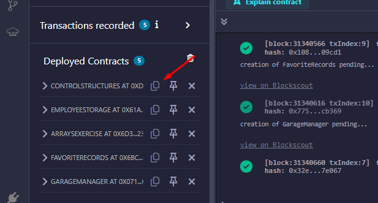
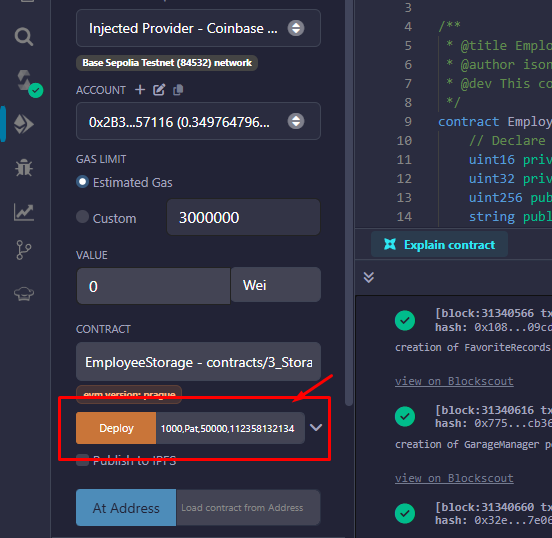
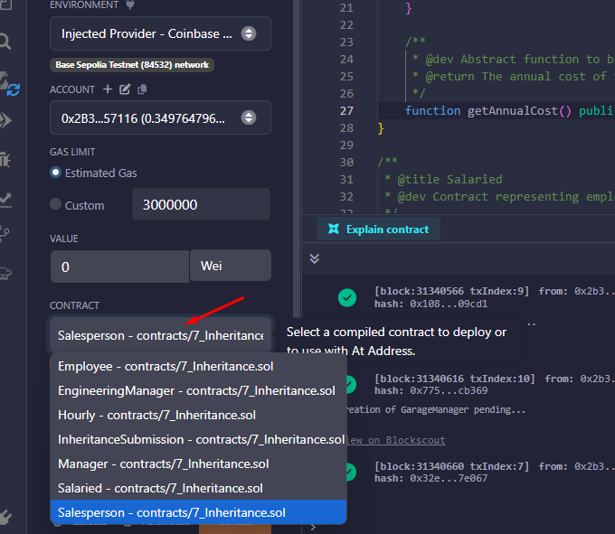
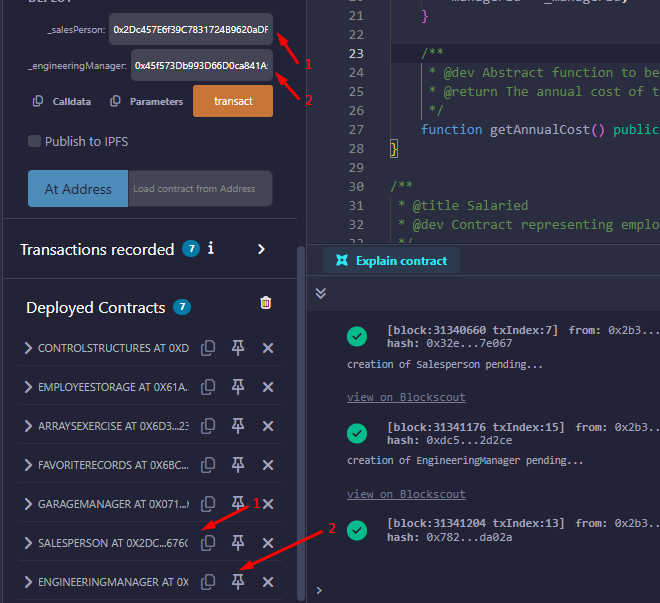

# Base Learning Project

## Deployment Instructions

Deploy contracts on [Remix Ethereum IDE](https://remix.ethereum.org)

## Getting Started

### Wallet Setup
1. Download and install [Coinbase Wallet](https://www.coinbase.com/wallet)
2. Create a new wallet or import an existing one
3. Connect your wallet to the Base Sepolia testnet

### Getting Test Tokens
1. Get Base Sepolia ETH from [OP Faucet](https://console.optimism.io/faucet) or bridge from ETH Sepolia
2. Alternative bridge: [SuperBridge](https://superbridge.app/?fromChainId=11155111&toChainId=84532)

### Network Configuration
- **Network Name**: Base Sepolia Testnet
- **RPC URL**: https://sepolia.base.org
- **Chain ID**: 84532
- **Currency Symbol**: ETH
- **Block Explorer**: https://sepolia.basescan.org

If you experience slow RPC connections, create a private RPC endpoint through [Alchemy](https://www.alchemy.com/).

## Tasks

1. Complete all tasks in the [Base Guild](https://guild.xyz/base)
2. Use a VPN if needed for accessing certain resources

## Deployment Exercises

1. [Deploy BasicMath](https://docs.base.org/learn/deployment-to-testnet/deployment-to-testnet-exercise)
2. [Deploy ControlStructures](https://docs.base.org/learn/control-structures/control-structures-exercise)
3. [Deploy EmployeeStorage](https://docs.base.org/learn/storage/storage-exercise) with parameters: 1000,Pat,50000,112358132134

   

4. [Deploy ArraysExercise](https://docs.base.org/learn/arrays/arrays-exercise)
5. [Deploy FavoriteRecords](https://docs.base.org/learn/mappings/mappings-exercise)
6. [Deploy GarageManager](https://docs.base.org/learn/structs/structs-exercise)
7. [Deploy Inheritance Contracts](https://docs.base.org/learn/inheritance/inheritance-exercise) in sequence:
    - Salesperson with parameters: 55555,12345,20
      
      
      
    - EngineeringManager with parameters: 54321,11111,200000
    - InheritanceSubmission with parameters: deployed address of Salesperson, deployed address of EngineeringManager
      
      

8. [Deploy ImportsExercise](https://docs.base.org/learn/imports/imports-exercise)
9. [Deploy ErrorTriageExercise](https://docs.base.org/learn/error-triage/error-triage-exercise)
10. [Deploy AddressBookFactory](https://docs.base.org/learn/new-keyword/new-keyword-exercise)
11. [Deploy UnburnableToken](https://docs.base.org/learn/token-development/minimal-tokens/minimal-tokens-exercise)
12. [Deploy WeightedVoting](https://docs.base.org/learn/token-development/erc-20-token/erc-20-exercise)
13. [Deploy HaikuNFT](https://docs.base.org/learn/token-development/erc-721-token/erc-721-exercise)

## Additional Resources

### Remix Deployment Guide
1. Open the Solidity file in Remix
2. Compile the contract using the Solidity Compiler tab
3. Go to the Deploy & Run Transactions tab
4. Connect Coinbase Wallet using the "Injected Provider" environment
5. Select the contract to deploy
6. Enter constructor parameters if required
7. Click "Deploy" and confirm the transaction in your wallet

### Base Sepolia Testnet
Base Sepolia is the recommended testnet for Base development. It provides a stable environment for testing smart contracts before deploying to mainnet.

### Troubleshooting
- If transactions fail, ensure you have sufficient testnet ETH
- Check that your wallet is connected to Base Sepolia testnet
- Verify contract parameters are correctly formatted

## Let's Connect! 🚀

### Need Help?
Got stuck or have questions? I'm just an email away! 
📧 **Email me**: isonnymichael@gmail.com

### Support This Project
If you found this guide helpful and want to buy me a coffee (or maybe some ETH for gas fees 😉), feel free to send some love to:

💰 **Donation Address**: `0x2B36425Aa21B034045876853DaA93f82f1357116`

Your support helps keep this project updated with the latest Base developments!